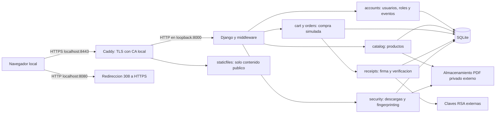
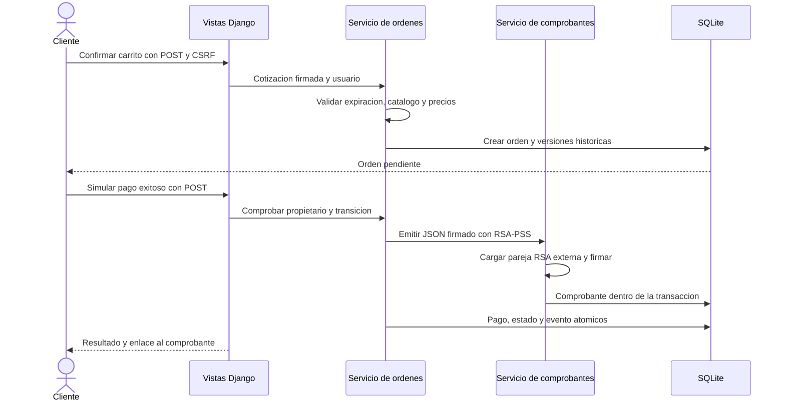
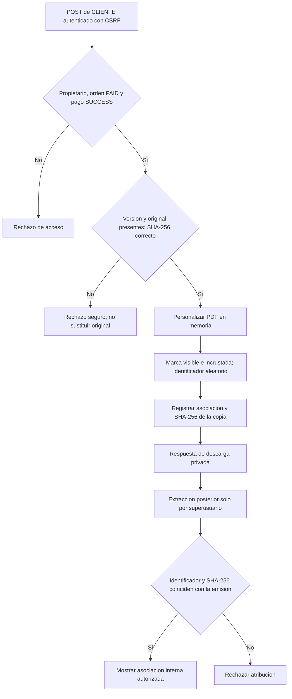

# Arquitectura del sistema

[Índice general](../README.md) · [Seguridad criptográfica](SEGURIDAD_CRIPTOGRAFICA.md)

## 1. Alcance y límites

Aplicación monolítica Django con plantillas del servidor, SQLite y archivos
privados externos. Los pagos son simulados. El perfil actual es local; no es
una infraestructura de producción ni incluye una VPN operativa.

## 2. Componentes implementados

Los puertos HTTP/HTTPS, Django y SSH observados están enlazados a `127.0.0.1`.
El proxy sustituye el protocolo reenviado y no publica el catálogo privado,
claves, SQLite o código. La raíz de confianza sigue incluyendo al equipo local.

## 3. Módulos y datos

| Módulo | Responsabilidad y persistencia |
| --- | --- |
| [accounts](../accounts) | Usuario personalizado, rol, hash de contraseña y eventos en SQLite; administración sensible restringida a superusuario. |
| [catalog](../catalog) | Nombre, descripción, precio, estado, nombre privado y SHA-256; binario PDF externo con nombre aleatorio. |
| [cart](../cart) | Carrito del CLIENTE y selección de productos publicados. |
| [orders](../orders) | Orden, líneas históricas, total, versión de PDF y un pago simulado por orden. |
| [receipts](../receipts) | Comprobante JSON canónico, identificador de clave, hash y firma en SQLite; privadas y públicas externas. |
| [security](../security) | Asociación del fingerprint con usuario/línea y SHA-256 del binario emitido; PDF personalizado generado en memoria, no archivado como binario por la aplicación. |
| [config](../config) | `.env` con prioridad del entorno, middleware, rutas, cookies y perfil HTTPS. |
| [scripts](../scripts) | Snapshot consistente SQLite, inventario de archivos y restauración aislada con manifiesto y SHA-256 confiable externo. |

La base no contiene todos los elementos necesarios para recuperar el servicio.
Se necesitan PDF, públicas históricas, código y dependencias; los secretos se
recuperan por un canal separado. Véase [respaldo y restauración](RESPALDO_RESTAURACION.md).

## 4. Compra y comprobante

El servicio calcula importes en el servidor. La cotización expira a los 15
minutos; una alteración o cambio relevante exige actualizar el carrito.
Confirmaciones repetidas no deben crear otra orden. Pago y firma comparten
transacción: si la emisión falla, no se consolida el éxito del pago.
Un pago fallido no genera comprobante.

## 5. Descarga y atribución

Una emisión registrada no demuestra que la transferencia de red haya terminado.
El proceso no cambia el original ni firma criptográficamente el PDF: la firma
RSA corresponde al comprobante JSON, no a la marca del documento.

## 6. Inicio, confianza y operación

El [lanzador](../Iniciar-Seguro.ps1) usa `$PSScriptRoot`, lee la configuración,
descifra dos blobs DPAPI binarios UTF-8 bajo CurrentUser, comprueba la pareja RSA
y ejecuta Django en loopback. Restaura las variables del proceso al terminar.
No inicia Caddy ni migra la base. Los secretos no se almacenan en `.env`.

SSH es un canal de administración del sistema, no un módulo Django.
La VPN futura envolvería el acceso a la red privada, pero necesitaría cambios
autorizados de interfaces, rutas y firewall: [propuesta VPN/IPsec](ARQUITECTURA_VPN_IPSEC.md).

## 7. Estado conocido

La [auditoría](AUDITORIA_SEGURIDAD.md) documenta cuatro PDF distintos ausentes,
cuatro líneas sin versión y dos comprobantes sin pública histórica disponible.
Son limitaciones históricas: restaurar lo incluido en un respaldo no reconstruye
material que ya faltaba. Las versiones actuales de productos y las claves
nuevas no deben utilizarse para reinterpretar compras o firmas anteriores.
