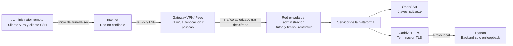

# Arquitectura propuesta de VPN/IPSec

## 1. Introducción

La plataforma procesa cuentas, órdenes, pagos simulados, comprobantes digitales
firmados y contenido PDF de distribución controlada. Además de proteger la
aplicación, resulta necesario proteger su administración: una sesión
administrativa comprometida podría permitir acceder al contenido privado,
modificar servicios o sustraer material criptográfico.

HTTPS y SSH protegen comunicaciones distintas. Una VPN basada en IPsec
complementaría ambos mecanismos mediante un canal de acceso a la red privada,
autenticado y sujeto a políticas. No sustituiría la autorización de Django,
las firmas de comprobantes, la protección de archivos ni la autenticación
propia de SSH. IPsec proporciona servicios en la capa de red sujetos a
políticas de seguridad.

## 2. Objetivo y límites

Proponer una VPN de acceso remoto, de cliente a gateway, con IKEv2 e IPsec en
modo túnel, para que únicamente administradores autorizados alcancen los
servicios de gestión de un futuro despliegue.

Objetivos específicos:

- Autenticar al administrador y al gateway antes de autorizar tráfico.
- Proteger confidencialidad, integridad y autenticidad del tráfico del túnel.
- Restringir los destinos y servicios accesibles por mínimo privilegio.
- Conservar SSH con claves Ed25519 y HTTPS con TLS como capas independientes.
- Definir pruebas y evidencias necesarias para aceptar una implementación futura.

La propuesta se limita al acceso administrativo. No exige que los compradores
utilicen VPN ni define la publicación comercial del sitio. No selecciona ni
instala un producto VPN, no asigna direcciones reales y no cambia Windows,
OpenSSH, Caddy, Django, claves o registros históricos.

## 3. Inspección y evidencia disponible

### 3.1 Fuentes locales revisadas

| Fuente | Hallazgos relevantes |
| --- | --- |
| [Configuración Django](../config/settings.py) | Carga `.env` con `override=False`. El perfil HTTPS rechaza `DEBUG=true`, establece cookies `Secure`, redirección SSL y confianza en `X-Forwarded-Proto`; no utiliza `X-Forwarded-Host`. |
| [Caddyfile](../Caddyfile) | HTTPS en `localhost:8443`, `tls internal`, escucha en `127.0.0.1`; HTTP en `localhost:8080` redirige con 308. El proxy envía a `127.0.0.1:8000` y sustituye el encabezado de protocolo. API administrativa desactivada. |
| [Lanzador seguro](../Iniciar-Seguro.ps1) | Exige perfil HTTPS, depuración desactivada y `ALLOWED_HOSTS=localhost`; recupera secretos mediante DPAPI CurrentUser. Arranca Django exclusivamente en `127.0.0.1:8000 --noreload`. No inicia una VPN. |
| [Ejemplo de entorno](../.env.example) | Documenta rutas ilustrativas y archivos DPAPI, sin valores secretos; separa el inicio de Caddy del de Django. |
| [Documentación HTTPS existente](../config/HTTPS_LOCAL.md) | Describe CA local, límites de loopback, confianza explícita y procedimientos de prueba TLS. Es una guía de desarrollo, no un despliegue de producción. |
| Configuración de OpenSSH en `%ProgramData%\ssh\sshd_config` | `Port 22`, `ListenAddress 127.0.0.1`, `PubkeyAuthentication yes`, `PasswordAuthentication no` y `KbdInteractiveAuthentication no`. Para el grupo de administradores establece un archivo de claves autorizadas específico. |

El origen confiable CSRF actual es `https://localhost:8443`. HSTS permanece
desactivado para este entorno local. No se modifican esas decisiones.

La guía HTTPS contiene ejemplos de preparación manual y rutas ilustrativas
de otro entorno; para el arranque automatizado actual corresponde consultar
el lanzador y el ejemplo de entorno. La raíz `.env` del proyecto sí se carga
actualmente; no debe confundirse con un archivo dentro de `config`.

### 3.2 Observaciones y límites de la revisión

Se consultaron el servicio SSH y las escuchas TCP sin alterarlos:

| Observación del 19/11/2026 | Interpretación y límite |
| --- | --- |
| Servicio `sshd` en ejecución | Confirma disponibilidad del proceso; no acredita una autenticación nueva. |
| Escucha `127.0.0.1:22` | SSH está limitado a loopback; no se observó una escucha SSH en una interfaz remota. |
| Escuchas `127.0.0.1:8080`, `127.0.0.1:8443` y `127.0.0.1:8000` | Coinciden con el perfil local de Caddy y Django. Una escucha no demuestra por sí sola el éxito de una conexión TLS. |
| Certificados públicos `root.crt` e `intermediate.crt` en el almacén local de Caddy del usuario | Se observó su existencia, sin leer claves privadas. No se estableció que ese almacén fuera el utilizado por el proceso activo. |

El equipo del proyecto reporta HTTPS operativo con CA local y certificado de
desarrollo, redirección HTTP a HTTPS y autenticación SSH mediante Ed25519.
La configuración leída es consistente con HTTPS local y autenticación SSH por
clave pública. **No se repitieron aquí pruebas TLS ni un inicio de sesión SSH.**

La consulta `sshd -T` no pudo completarse y devolvió
`no hostkeys available -- exiting`. Además, la lectura del archivo de claves
autorizadas de administradores fue denegada por permisos. No se elevaron
privilegios ni se cambiaron ACL para continuar. Estos resultados no demuestran
que el servicio en ejecución carezca de claves; limitan la comprobación
independiente de su configuración efectiva y del algoritmo autorizado. No se
encontró configuración de cliente en las ubicaciones de usuario y global
consultadas.

Por tanto, se distingue entre **configuración inspeccionada**, **escuchas
observadas**, **funcionamiento reportado por el equipo** y **pruebas pendientes**.
No se produjeron capturas ni resultados de una VPN.

## 4. Arquitectura propuesta



**Todo acceso remoto de este diagrama es una propuesta.** El túnel IPsec
abarcaría desde el cliente del administrador hasta el gateway; Internet
representa el medio de tránsito, no un extremo criptográfico adicional.
Después del gateway el tráfico circularía por la red privada: ese tramo no
queda cifrado automáticamente por el túnel de acceso remoto. SSH y TLS
conservarían su protección hasta sus respectivos servidores.

Como ejemplo exclusivamente documental:

| Elemento | Valor ilustrativo | Función |
| --- | --- | --- |
| Rango de clientes VPN | `10.77.0.0/24` | Asignación a administradores autenticados. |
| Servidor privado | `10.20.0.10` | Destino autorizado de administración. |
| Nombre del servicio web | `plataforma.example` | Nombre reservado para ejemplos; no es un servicio desplegado. |

Estas direcciones no describen la red actual. Antes de utilizarlas habría que
comprobar solapamientos, enrutamiento de ida y vuelta, DNS y políticas de acceso.
Se propone un gateway separado del servidor, sin asumir que una dirección
privada o la pertenencia a la VPN otorguen confianza ilimitada.

## 5. Funcionamiento de IKEv2 e IPsec

### 5.1 Negociación inicial: `IKE_SA_INIT`

Cliente y gateway negociarían algoritmos, intercambiarían valores aleatorios
(*nonces*) y realizarían un intercambio Diffie-Hellman. A partir de ese
intercambio derivarían material de claves para proteger la negociación
posterior. Esta etapa por sí sola **no autentica las identidades**.

### 5.2 Autenticación: `IKE_AUTH`

Se autenticarían las identidades y el intercambio previo. Se propone validar
el certificado y la identidad del gateway frente a una autoridad confiable,
y utilizar credenciales individuales para los administradores, preferentemente
certificados de cliente o un método EAP apropiado al producto seleccionado.

La política debería exigir un segundo factor mediante un mecanismo y backend
compatibles, cuya integración tendría que diseñarse y probarse. IKEv2, un
certificado o una clave protegida por contraseña no implican automáticamente
que exista MFA operacional. No se propone una contraseña o PSK compartida
entre todos los administradores.

La primera asociación para tráfico IPsec, o **Child SA**, normalmente se
establece durante `IKE_AUTH`; algunos métodos de autenticación requieren
intercambios adicionales. La IKE SA protege el plano de control y las SA
IPsec protegen el tráfico de datos. Se acuerdan selectores de tráfico y
parámetros; autenticar al usuario no equivale a autorizar toda la red.

### 5.3 Protección de datos con ESP

En modo túnel, el paquete IP original se encapsularía dentro de otro paquete.
ESP proporcionaría cifrado e integridad/autenticación mediante una combinación
criptográfica aprobada y protección antirrepetición con números de secuencia
y una ventana de recepción.

Se propone preferir cifrado autenticado, por ejemplo AES-GCM, según
compatibilidad y política vigente, sin habilitar cifrado nulo ni algoritmos
obsoletos. La cabecera IP exterior, necesaria para enrutar, y patrones como
tiempos y tamaños no quedan completamente ocultos. La autenticación de
paquetes no identifica por sí sola al usuario de una operación Django.

IKEv2 suele utilizar UDP 500 y, cuando se negocia encapsulación UDP para
atravesar NAT, UDP 4500. Sin encapsulación UDP, ESP utiliza el **protocolo IP
50**, no un «puerto 50». Esta descripción no implica que deban abrirse
estos protocolos en la laptop actual.

### 5.4 Renovación y terminación

Se definirían tiempos de vida y límites de uso, renovación mediante
`CREATE_CHILD_SA`, detección de pares inactivos y eliminación de SA al terminar
la sesión. Se requeriría intercambio Diffie-Hellman adicional durante la
renovación de Child SA cuando se exija PFS independiente entre renovaciones.
No se intercambian directamente las claves privadas de identidad.

La selección final de algoritmos de IKE y ESP debe revisarse por separado,
considerando su solidez, compatibilidad y las actualizaciones de seguridad
vigentes al desplegar. La compatibilidad de algoritmos no constituye una
certificación ni una política completa de despliegue.

## 6. Integración propuesta con SSH

### 6.1 Capas independientes de autenticación

Tras establecer la VPN, el administrador obtendría acceso únicamente a la
dirección y puerto SSH autorizados. Después, OpenSSH comprobaría la cuenta y
la clave pública Ed25519 autorizada, mientras el cliente verificaría la clave
de host del servidor por un canal confiable.

La clave privada SSH permanecería en el equipo del administrador, protegida
por permisos y una frase de paso o mecanismo equivalente. No se copiaría al
gateway ni al servidor. Las claves de usuario SSH, las claves de host SSH,
las credenciales VPN, los certificados TLS y la RSA de comprobantes tienen
funciones distintas y no deben reutilizarse.

### 6.2 Incompatibilidad con el enlace actual a localhost

**Actualmente SSH escucha exclusivamente en `127.0.0.1:22`. Por ello no puede
recibir directamente conexiones remotas a través de una VPN.** El loopback del
cliente remoto apunta al propio cliente, no al servidor. Agregar una ruta VPN
o una regla de firewall no cambia la dirección en la que escucha `sshd`.

En un futuro despliegue autorizado sería necesario:

1. Definir una interfaz y una dirección privada de gestión del servidor.
2. Revisar `ListenAddress` para enlazar SSH a esa dirección concreta, evitando
   una exposición indiscriminada en todas las interfaces.
3. Configurar rutas de ida y retorno entre clientes VPN y servidor.
4. Autorizar TCP 22 únicamente desde los clientes VPN autorizados, con
   controles tanto en gateway como en firewall del servidor; no publicarlo
   mediante redirecciones de puertos del router.
5. Mantener deshabilitadas contraseña y autenticación interactiva, restringir
   cuentas o grupos, revisar ACL de claves autorizadas y limitar privilegios.
6. Validar la configuración con permisos adecuados y planificar el reinicio
   de SSH con respaldo y acceso local de recuperación.

**Ninguno de esos cambios se realiza con este documento.** Una vez aprobado e
implementado el diseño, un ejemplo de uso sería:

```powershell
# Solo ilustrativo; requiere antes el despliegue VPN y SSH privado autorizado.
ssh -i "$env:USERPROFILE\.ssh\id_ed25519" operador@10.20.0.10
```

El éxito de la VPN no debe permitir eludir una clave SSH incorrecta, una
cuenta deshabilitada ni los permisos del sistema operativo.

## 7. Integración independiente con HTTPS

TLS protegería la conexión entre navegador y Caddy, incluso si ya viaja dentro
del túnel. Aporta autenticación del servidor web e integridad y
confidencialidad de la sesión HTTPS. SSH protege la sesión administrativa y
ESP protege el tráfico entre los extremos VPN: son límites diferentes.

En el entorno actual:

- Caddy termina TLS con su CA local y certificado de desarrollo para
  `localhost`; HTTP en 8080 redirige a HTTPS en 8443.
- `skip_install_trust` evita instalar automáticamente la CA. La confianza
  explícita en ella debe decidirse y verificarse por separado.
- Caddy sustituye `X-Forwarded-Proto` y se comunica con Django por HTTP en
  `127.0.0.1:8000`; ese salto local no es un túnel IPsec ni una conexión TLS.
- Las cookies seguras y CSRF siguen siendo controles de aplicación necesarios.

**Caddy también está limitado a loopback.** Para acceso web remoto directo por
VPN sería necesario definir un nombre DNS y dirección privada alcanzables,
adaptar el enlace de Caddy y el certificado a ese nombre, y restringir el
firewall al origen autorizado. El certificado para `localhost` no debe
aceptarse como válido para otro nombre o IP.

También se tendrían que revisar `ALLOWED_HOSTS`, `CSRF_TRUSTED_ORIGINS` y la
restricción de `localhost` del lanzador, preservando HTTPS y la confianza en
encabezados exclusivamente desde el proxy controlado. Django permanecería en
loopback, sin acceso directo desde clientes VPN. En producción se sustituiría
`runserver` por un servidor WSGI/ASGI apropiado.

Estas adaptaciones están **pendientes**, no implementadas. La CA de desarrollo
no se convierte en una CA VPN ni en una infraestructura de producción por
habilitar un túnel.

## 8. Controles de seguridad propuestos

| Área | Control requerido para un despliegue futuro |
| --- | --- |
| Autenticación VPN | Identidades individuales, validación del gateway, revocación y caducidad; segundo factor compatible y probado. |
| Cifrado | IKEv2, intercambio de claves robusto y ESP autenticado; algoritmos aprobados, renovación y antirrepetición. |
| Acceso | Grupo administrativo específico y mínimo privilegio; selectores de tráfico y políticas de gateway acotados a servicios autorizados. |
| Firewall | Denegar por defecto; separar reglas del túnel y del tráfico interno. Contemplar IPv4 e IPv6 y evitar rutas alternativas que eludan el gateway. |
| Equipos remotos | Actualizaciones, protección del dispositivo, bloqueo de sesión y control de pérdida o robo. |
| Gestión de claves | Inventario, responsables, emisión, rotación, revocación y respaldos protegidos; claves distintas para cada propósito. |
| Servidor y gateway | Parches, administración restringida, configuración respaldada y acceso de recuperación controlado. |
| Registros | Eventos de VPN, identidad y dirección asignada, sesiones SSH, decisiones de firewall y eventos de aplicación; sincronización horaria y correlación. |
| Protección de registros | ACL, retención definida y copia a un destino protegido; no registrar contraseñas, claves privadas ni contenido sensible. |

La protección actual mediante DPAPI de secretos de Django y RSA es un control
local, no un sustituto de la gestión de identidades VPN ni una protección
frente a todos los procesos ejecutados como el usuario autorizado.

### 8.1 Matriz de acceso de referencia

La siguiente matriz es una política propuesta, **no reglas instaladas**:

| Origen | Destino | Servicio | Política propuesta |
| --- | --- | --- | --- |
| Administrador remoto | Gateway VPN | UDP 500/4500 y ESP cuando corresponda | Solo lo necesario para IKEv2/IPsec, con controles de abuso. |
| Cliente VPN autorizado | Interfaz privada del servidor | TCP 22 | Permitir solo a administradores con autorización SSH. |
| Cliente VPN autorizado | Interfaz privada de Caddy | TCP 443 o 8443, según diseño aprobado | Permitir HTTPS administrativo con certificado válido. |
| Cliente VPN o Internet | Django | TCP 8000 | Denegar acceso directo; mantener backend en loopback. |
| Internet sin VPN | SSH privado | TCP 22 | Denegar. |
| Cliente VPN | Otros equipos y servicios internos | Cualquier otro destino no autorizado | Denegar; impedir movimiento lateral. |

El tráfico de retorno se permitiría por estado y rutas explícitas. Si el
gateway aplicase NAT, se debería evaluar la pérdida de identidad de origen
en el servidor y conservar su correlación en los registros. Se prefiere un
diseño enrutado que facilite atribución y reglas precisas.

## 9. Riesgos y limitaciones

| Riesgo | Consecuencia posible | Mitigación y límite |
| --- | --- | --- |
| Compromiso de credenciales VPN | Acceso al segmento administrativo o uso de sesiones activas. | Revocar credenciales, terminar SA/sesiones y revisar eventos; MFA y segmentación reducen el alcance, no eliminan el riesgo. |
| Robo de clave privada SSH | Suplantación del administrador en servidores donde esté autorizada, si logra alcanzarlos y utilizar la clave. | Revocar la clave pública autorizada, proteger la privada y revisar accesos. La VPN no corrige una clave robada ni protege de un atacante ya conectado. |
| Compromiso del gateway | Terminación del túnel bajo control del atacante, exposición del tráfico descifrado y manipulación de rutas o políticas. | Aislamiento, parches, registros externos y recuperación segura. TLS y SSH verificados correctamente mantienen una capa adicional frente al gateway. |
| Compromiso del cliente o servidor | Lectura de datos antes del cifrado o después del descifrado; abuso de credenciales y permisos. | Seguridad de endpoints y mínimo privilegio. Ningún túnel protege por sí solo un extremo comprometido. |
| Rutas, DNS o reglas demasiado amplias | Fugas, exposición de servicios o movimiento lateral; IPv6 podría eludir controles solo IPv4. | Validar ambos sentidos del tráfico, selectores y filtrado; revisar túnel dividido y política DNS. |
| Caída, saturación o denegación de servicio del gateway | Pérdida de administración remota. | Monitoreo, límites de abuso y recuperación local; alta disponibilidad según necesidad. |
| Sobrecarga del túnel y MTU | Fragmentación, lentitud o fallos de conexión. | Medición de MTU, rendimiento y renovación en un laboratorio autorizado. |

Una VPN no garantiza anonimato, no oculta todo metadato de red y no sustituye
copias de seguridad ni controles de integridad del contenido. Tampoco se
declara certificación ni resistencia poscuántica por utilizar estos mecanismos.

## 10. Plan de pruebas propuesto

### 10.1 Condiciones previas

Todas las pruebas de esta sección están **pendientes de ejecución**. Requieren
autorización, laboratorio aislado, producto VPN seleccionado, direcciones y
políticas aprobadas, cuentas de prueba y acceso local de recuperación.
La configuración actual de loopback no satisface esos requisitos.

Se debe conservar evidencia fechada y anonimizada: configuración no secreta,
identificador de caso, origen/destino, resultado observado y eventos
correlacionados. Nunca se deben adjuntar claves privadas o credenciales.
No se utilizarán órdenes, pagos o comprobantes históricos para generar tráfico
de prueba; se emplearán recursos de laboratorio.

| Caso | Procedimiento futuro | Criterio de aceptación | Estado |
| --- | --- | --- | --- |
| VPN-01 | Conectar un administrador autorizado con credenciales válidas. | IKE SA y Child SA establecidas; identidad, dirección asignada y selectores coinciden con la política. | Pendiente |
| VPN-02 | Intentar conexión con usuario no autorizado o credencial incorrecta. | No se autoriza el túnel de datos; queda registro del rechazo sin secretos. | Pendiente |
| VPN-03 | Presentar certificado VPN caducado o revocado y, por separado, un gateway no confiable. | Rechazo de autenticación conforme a la política; el cliente no omite la validación del gateway. | Pendiente |
| VPN-04 | Acceder por VPN al SSH privado con Ed25519 autorizado. | Sesión aceptada tras verificar la identidad del servidor; sin exigir ni aceptar contraseña como alternativa. | Pendiente |
| VPN-05 | Repetir con clave SSH no autorizada y cuenta sin permisos. | Rechazo SSH aunque el túnel VPN sea válido. | Pendiente |
| VPN-06 | Abrir el HTTPS autorizado con nombre DNS y CA confiables. | Cadena y nombre válidos; acceso al servicio web permitido. Una CA o nombre incorrectos deben rechazarse. | Pendiente |
| VPN-07 | Intentar acceso desde fuera de VPN a SSH y a la interfaz administrativa privada. | No se establece la conexión; registros coherentes con la denegación. | Pendiente |
| VPN-08 | Intentar desde la VPN acceso directo a TCP 8000 y a servicios internos no autorizados. | Acceso bloqueado y ausencia de rutas alternativas, tanto en IPv4 como en IPv6. | Pendiente |
| VPN-09 | Observar tráfico en la interfaz externa del laboratorio con autorización. | Se identifica IKE/ESP o su encapsulación UDP; no se observa el contenido interno en claro. No se interpreta esto como una auditoría criptográfica completa. | Pendiente |
| VPN-10 | Renovar SA y terminar o revocar una sesión. | Renovación según política; después de terminarla, el tráfico protegido deja de estar autorizado y el evento queda registrado. | Pendiente |
| VPN-11 | Correlacionar conexión VPN, acceso SSH y una consulta web no modificadora. | Tiempos e identidades trazables entre componentes sin exposición de secretos. | Pendiente |
| VPN-12 | Evaluar desconexión, recuperación y MTU con tráfico de prueba. | Sin caída a rutas no autorizadas; recuperación documentada y sin cambios en datos históricos. | Pendiente |

No se ofrecen tasas de éxito, latencias, capturas ni resultados de penetración,
porque no se han realizado estas pruebas.

## 11. Estado de implementación

| Mecanismo | Estado | Evidencia y alcance |
| --- | --- | --- |
| Perfil HTTPS Django/Caddy | Implementado; funcionamiento reportado por el equipo | Archivos inspeccionados y escuchas locales observadas. No se repitió una negociación TLS en esta revisión documental. |
| CA local y certificado de desarrollo | Existentes según evidencia del proyecto | `tls internal`, guía HTTPS y certificados públicos observados; no se auditaron claves ni confianza global. |
| Redirección HTTP a HTTPS | Implementada en configuración | Caddy declara 308 de 8080 a 8443; Django activa redirección en su perfil HTTPS. Sin nueva prueba HTTP en esta tarea. |
| Cookies seguras y CSRF | Implementados en configuración | Perfil sin depuración y origen confiable local inspeccionados. |
| OpenSSH para Windows | Implementado y servicio observado en ejecución | Configuración leída y escucha en `127.0.0.1:22` observada. |
| Autenticación SSH con Ed25519 | Implementada según evidencia aportada por el equipo | Se confirmó habilitación de clave pública en archivo; no se pudo inspeccionar el archivo protegido de claves autorizadas ni se repitió un inicio de sesión. |
| Contraseña SSH deshabilitada | Configurada | `PasswordAuthentication no` y `KbdInteractiveAuthentication no` leídos; no se ejecutó prueba de rechazo de contraseña. |
| Acceso remoto directo a SSH/Caddy | No habilitado por el perfil local | Ambos servicios están enlazados a loopback. |
| Gateway, IKEv2, túnel ESP, MFA y políticas VPN | Únicamente propuestos | Sin instalación, configuración o pruebas VPN realizadas. |
| Matriz de firewall y plan de pruebas VPN | Diseño pendiente | No se aplicaron reglas, rutas o aperturas de puertos. |

## 12. Conclusión

La VPN/IPsec propuesta establecería una primera barrera de autenticación y
acceso a la red administrativa. SSH con Ed25519 protegería la administración
del sistema y HTTPS mediante Caddy protegería las conexiones web, aun dentro
del túnel. Cada capa conservaría sus propias claves, autorizaciones y
registros.

El estado actual es un entorno local protegido, no una VPN funcional.
Convertirlo en un acceso remoto requeriría un despliegue separado y autorizado:
gateway, identidades, rutas, interfaces privadas, DNS, certificados y firewall,
manteniendo Django fuera del alcance directo. La aceptación dependería de
ejecutar y documentar el plan de pruebas, no de la existencia de este diseño.

